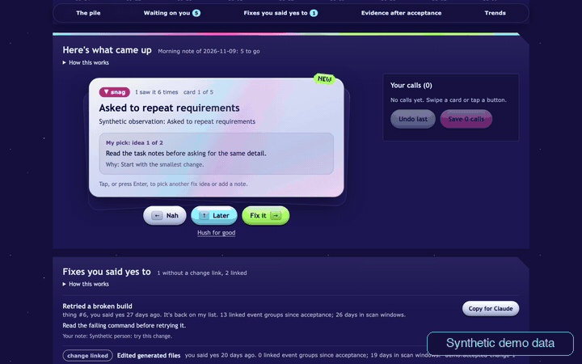
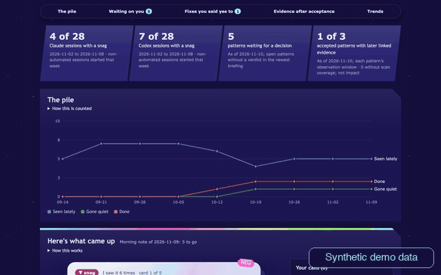

# Agent REM

A morning review of the mistakes your coding agents keep repeating.



## Why this exists

- REM reads local Claude Code and Codex session histories and groups recurring friction into proposals you can review.
- Your decisions stay in a SQLite ledger, alongside the observations and proposed changes.
- REM proposes changes; it does not implement them. You choose what to accept, defer, dismiss or silence.

### Why not just add rules to CLAUDE.md?

A rule is an instruction for future work. REM adds a record of recurring observations, your decisions, and later linked evidence. That record helps you decide what deserves a rule. It also means keeping a ledger and reviewing proposals, instead of only maintaining an instruction file.

Linked evidence after acceptance does not establish whether a change helped. The demo illustrates a reviewable history, not an effectiveness study.

## Requirements

The demo needs Python with its standard-library SQLite support, Bash, a web browser, and a REM source checkout. Running the tests also needs pytest. The synthetic demo needs no model or transcript archive. Live nightly classification uses an authenticated Claude Code CLI; the two supported transcript sources are Claude Code and Codex. A Codex-only setup can run the demo, but the nightly job still needs Claude Code.

## Quick Start

Run this from the repository root:

```bash
bash demo/run.sh
```

Open the address printed in the terminal. The script creates synthetic data in a temporary folder and starts REM's page on loopback. Stop it with Ctrl-C to remove that folder. Scheduler controls are disabled in the demo; triage and settings affect only its temporary data.

The synthetic demo contains eight weeks of nights, with changing friction, pending decisions, accepted patterns that went quiet, a pattern that recurred more often, untreated patterns, and a failed final run. These are invented examples, not usage results or evidence that a fix works.

To keep a demo ledger and use the actual CLI separately:

```bash
demo_data=$(mktemp -d)
export PYTHONPATH="$PWD${PYTHONPATH:+:$PYTHONPATH}"
export PYTHONDONTWRITEBYTECODE=1
export CONSOLIDATE_DB="$demo_data/events.db"
export CONSOLIDATE_JOURNAL_DIR="$demo_data/journals"
export REM_SETTINGS="$demo_data/settings.json"
python3 demo/seed_demo.py "$demo_data"
bash bin/rem ledger
bash bin/rem actions
```

The seed command refuses a non-empty destination. Its fixed random seed and date anchor reproduce the same ledger; use `--today YYYY-MM-DD` to pin that anchor. It generates data from constants and never scans existing databases, journals or transcripts.

For a short terminal recording, run `bash demo/terminal-demo.sh`. It types the displayed commands at a readable pace, runs the real ledger and action-preview CLI, pauses after output, and cleans up its temporary data. The preview uses the last successful briefing because the final demo run failed.

To run REM on your own sessions, follow [docs/usage.md](docs/usage.md).



## Features

- Overview tiles show each agent's sessions with a snag for a stated week, pending decisions, and accepted patterns with later linked evidence.
- Friction charts separate Claude Code and Codex sessions and show scan-coverage gaps.
- Review cards offer “Fix it”, “Later”, “Nah” and “Hush for good”; choices are saved only when you press Save.
- Accepted proposals retain their decision history and can carry a change reference. Acceptance and implementation are distinct.
- Evidence after acceptance reports linked event groups and days in scan windows, with earlier evidence available to inspect.
- `rem ledger` shows the accumulated history; `rem actions` turns accepted proposals into text you can take into a working session.
- An optional agent workflow lives in `commands/`, `skills/` and `weft-templates/`. It expects [Weft](https://github.com/dioptx/weft) and Plannotator. REM runs without them.

## Repository Layout

| Path | Purpose |
| --- | --- |
| `bin/rem` | CLI entry point |
| `rem/` | Database, extraction, nightly coordination, review and serving |
| `rem/static/index.html` | The analytics and triage page |
| `prompts/` | Classification and briefing prompts |
| `tests/` | Runtime tests |
| `commands/`, `skills/`, `weft-templates/` | Optional agent workflow |
| `demo/` | Synthetic seed, launcher, CLI recording and seed tests |
| `docs/demos/` | README GIFs and the terminal recording |
| `CLAIMS.md` | Evidence for the claims in this README |
| `docs/usage.md` | Setup, nightly use and configuration |

## License

MIT. See [LICENSE](LICENSE).
